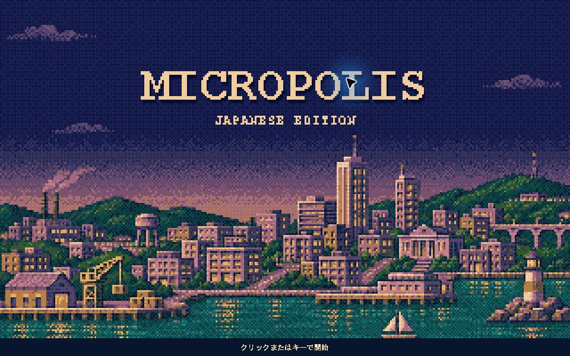

# Micropolis 日本語化・改良版

[dheid/micropolis](https://github.com/dheid/micropolis) を基にした、非公式の日本語化・改良版です。
MicropolisJ（Java版Micropolis）の都市シミュレーションと既存の画像・音声を引き継いでいます。
SimCityやElectronic Artsの公式製品・公式日本語版ではありません。

## 日本語表示の例

このフォークの実際のゲーム画面です。更地の新規都市で、日本語メニューとダイアログを表示しています。


|                        起動画面                         |                      予算ダイアログ                       |
|-----------------------------------------------------|----------------------------------------------------|
|  |  |

起動時には独自のレトロ調スプラッシュを表示します。クリックまたはキーでスキップできます。



## この版の変更

2026-11-02時点でmainに反映した変更:

- メニュー、予算、都市評価、地区照会、通知の日本語化。
- 英語原文を基準に日本語訳を再検討し、地区名などの用語を統一。
- 建物と煙の画像を順番に合成し、煙のあるタイルで建物が消える問題を修正。
- 外部BGMの再生を追加。PCM WAV、MP3、Ogg Vorbis、FLACと、Windows x64向けのSPC再生に対応。
- XMLでタイトル、都市の発展段階、災害、都市評価、人口到達時の祝賀を選曲。切り替え時のフェード、ループ、割り込みの優先順位を設定可能。
- BGMと効果音の音量を個別に調整できる設定画面を追加。
- 独自画像による起動スプラッシュを追加。画像の作成記録と無効化の方法は [docs/splash.md](docs/splash.md) を参照。
- Windowsの起動スクリプトでJava 25以降を検出し、古いJavaが設定されていても対応版を選択。
- 依存ライブラリ・対応ソース・ライセンス文書をまとめた配布ZIPを作成できるように変更。
- 日本語リソース、画像合成、BGM設定・選曲・デコード、スプラッシュの回帰テストを追加。
- ライセンスの追加条件を復元し、起動手順を更新。

翻訳の範囲・方針は [docs/localization-status.md](docs/localization-status.md) を参照してください。

## ビルドと起動

Java **25** のJDKとApache Mavenが必要です。特定のIDEは必要ありません。
`java -version` と `mvn -version` で使用するJavaを確認してください。
起動スクリプトのJava自動検出はMavenには適用されないため、MavenもJava 25を使うように設定してください。

### Javaだけでビルドする場合

```sh
mvn clean package
java --enable-native-access=ALL-UNNAMED -Duser.language=ja -Duser.country=JP -jar target/micropolis-2.0.0.jar
```

英語で起動する場合:

```sh
java --enable-native-access=ALL-UNNAMED -Duser.language=en -Duser.country=US -jar target/micropolis-2.0.0.jar
```

このビルドでは一般音声4形式を利用できます。SPCには次のネイティブライブラリも必要です。

### Windows x64でSPC再生も含める場合

Java 25・Mavenに加え、CMakeとVisual Studio 2022のC++ビルドツールが必要です。

```powershell
mvn clean
./scripts/build-spc.ps1
mvn package
./start-micropolis.ps1
```

SPCのビルド後に `mvn clean` を実行すると、作成したDLLも削除されます。
再ビルドするときも上記の順序で実行してください。他OSでのSPC再生は未検証です。

### Windowsの起動スクリプト

ビルド後、プロジェクトのフォルダで次を実行します。Windows PowerShell 5.1でも利用できます。

```powershell
./start-micropolis.ps1
```

日本語は `start-micropolis.ps1`、英語は `start-micropolis-original.ps1` です。
`original` は表示言語が英語という意味です。描画修正などを取り消した版ではありません。
`start-micropolis-common.ps1` は共通処理で、単独では起動に使いません。

Java 25以降を、`JAVA_HOME`、`PATH`、ユーザーフォルダの `.jdks` の順に探します。
古いJavaはスキップします。このゲームだけJavaを指定する場合は `MICROPOLIS_JAVA_HOME` を設定してください。
システム全体の `JAVA_HOME` は変更しません。

スクリプトは同じフォルダのJARを優先し、なければ `target/` のJARを使用します。
配布ZIPを展開した場合も、展開先の起動スクリプトを使用できます。

### 配布用ファイル

`mvn package` で `target/micropolis-2.0.0-dist.zip` を作成します。
JAR、`lib/`、SPCビルド済みなら `native/`、依存ライブラリの対応ソース、説明書とライセンスを含みます。
JARだけを取り出さず、ZIP内の配置を保って使用してください。

## BGMの設定

初回は「設定 → BGM設定...」で音楽パックのXMLを選び、BGMを有効にしてください。
設定ファイルと音量は次回起動時にも引き継ぎます。XMLを変更した後は「再読み込み」を押します。
サンプルは [examples/music.xml](examples/music.xml)、全設定と制限は [docs/music.md](docs/music.md) を参照してください。

音楽は各自で用意します。音楽未設定でも遊べます。
公開スクリプトは特定の音楽パックを指定せず、保存済みのBGM設定を読み込みます。
音楽ファイル・ROM・取り出した音源・手元専用の取り出し器や起動補助スクリプトは配布しません。

都市評価では市長への支持率50%を境に曲を使い分け、評価画面を閉じると通常曲へ戻ります。
災害や人口到達の曲は設定した時間だけ割り込み、終了時点の画面・都市クラスに合う曲へ戻ります。
評価や祝賀を定義していない既存の音楽パックも引き続き利用できます。

## 開発

- `src/main/java/micropolisj/engine/`: 都市シミュレーション、地形生成、災害、予算、保存処理。
- `src/main/java/micropolisj/gui/`: Swingの画面とタイル描画。
- `src/main/java/micropolisj/audio/`: 音楽設定、選曲、ストリーミング再生、デコーダー接続。
- `src/main/resources/strings/`: 言語別リソース。無印が英語、`_ja` が日本語です。
- `src/main/resources/graphics/`: タイル画像と合成レシピ。
- `src/test/java/`: JUnitによる回帰テスト。

```sh
mvn test
```

Mavenの通常ビルドはSpotlessでソースを整形します。調査時などに整形を避けたい場合は
`mvn -Dspotless.skip=true test` を使用してください。

ゲーム内の保存形式は `.cty` です。保存データは各自で管理してください。

## 出自とライセンス

このJava版の直接の上流は [dheid/micropolis](https://github.com/dheid/micropolis) です。
その基となった [MicropolisJ](https://github.com/SimHacker/micropolis/tree/master/micropolis-java)
はJason Longが2013年に公開したJava版です。
オリジナルのSimCityはWill Wrightが開発し、Don HopkinsがOLPC向けに
[Micropolis](https://github.com/SimHacker/micropolis) をオープンソースとして公開しました。

Copyright (C) 2013 Jason Long (jason@long.name).
Portions Copyright (C) 1989-2007 Electronic Arts Inc.

本ソフトウェアはGNU GPL version 3、またはそれ以降の版、および上流由来の追加条件に従います。
[LICENSE](LICENSE) にGPL本文、[NOTICE](NOTICE) に追加条件・著作権・免責の原文を収録しています。
既存のファイル単位の権利表記も維持してください。
ソースのヘッダーが参照する追加条件の原文は、本配布ではNOTICEに収録しています。
SimCityなどのElectronic Artsの商標を使用する権利や、同社との提携関係は与えられません。

日本語訳はこのリポジトリの英語リソースを基準とします。
市販版のディスクイメージ、抽出データ、攻略本などは配布物に含みません。
ソースを配布する場合はREADME・LICENSE・NOTICEを含めてください。
JARを配布する場合は、それに対応するソースも同じ配布場所から入手できるようにしてください。

この改良版のソースコード配布先は
[you-sk/micropolis-ja](https://github.com/you-sk/micropolis-ja) です。
