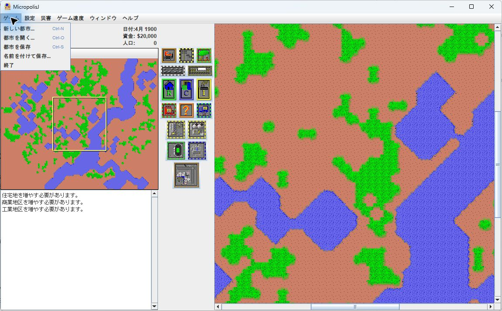
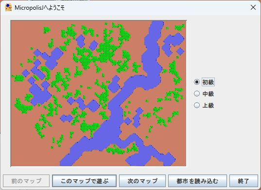
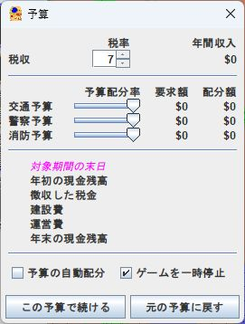

# Micropolis 日本語化・改良版

[dheid/micropolis](https://github.com/dheid/micropolis) を基にした、非公式の日本語化・改良版です。
MicropolisJ（Java版Micropolis）の都市シミュレーションと既存の画像・音声を引き継いでいます。
SimCityやElectronic Artsの公式製品・公式日本語版ではありません。

## 日本語表示の例

このフォークの実際のゲーム画面です。更地の新規都市で、日本語メニューとダイアログを表示しています。



| 起動画面 | 予算ダイアログ |
| --- | --- |
|  |  |

## この版の変更

2026-11-01時点の変更:

- メニュー、予算、都市評価、地区照会、通知の日本語化。
- 英語原文を基準に日本語訳を再検討し、地区名などの用語を統一。
- 建物と煙の画像を順番に合成し、煙のあるタイルで建物が消える問題を修正。
- 日本語リソースと画像合成の回帰テストを追加。
- ライセンスの追加条件を復元し、起動手順を更新。

翻訳の範囲・方針は [docs/localization-status.md](docs/localization-status.md) を参照してください。

## ビルドと起動

Java **25** のJDKとApache Mavenが必要です。特定のIDEは必要ありません。
`java -version` と `mvn -version` で使用するJavaを確認してください。

```sh
mvn clean package
java -Duser.language=ja -Duser.country=JP -jar target/micropolis-2.0.0.jar
```

英語で起動する場合:

```sh
java -Duser.language=en -Duser.country=US -jar target/micropolis-2.0.0.jar
```

Windows PowerShellでは、ビルド後に次のスクリプトも使用できます。
`JAVA_HOME` のJavaを優先し、未指定の場合は `PATH` のJavaを使用します。

```powershell
./start-micropolis.ps1
./start-micropolis-original.ps1
```

`original` は表示言語が英語という意味です。描画修正などを取り消した版ではありません。

## 開発

- `src/main/java/micropolisj/engine/`: 都市シミュレーション、地形生成、災害、予算、保存処理。
- `src/main/java/micropolisj/gui/`: Swingの画面とタイル描画。
- `src/main/resources/strings/`: 言語別リソース。無印が英語、`_ja` が日本語です。
- `src/main/resources/graphics/`: タイル画像と合成レシピ。
- `src/test/java/`: JUnitによる回帰テスト。

```sh
mvn test
```

Mavenの通常ビルドはSpotlessでソースを整形します。調査時などに整形を避けたい場合は
`mvn -Dspotless.skip=true test` を使用してください。

ゲーム内の保存形式は `.cty` です。保存データは各自で管理してください。

## 出自とライセンス

このJava版の直接の上流は [dheid/micropolis](https://github.com/dheid/micropolis) です。
その基となった [MicropolisJ](https://github.com/SimHacker/micropolis/tree/master/micropolis-java)
はJason Longが2013年に公開したJava版です。
オリジナルのSimCityはWill Wrightが開発し、Don HopkinsがOLPC向けに
[Micropolis](https://github.com/SimHacker/micropolis) をオープンソースとして公開しました。

Copyright (C) 2013 Jason Long (jason@long.name).
Portions Copyright (C) 1989-2007 Electronic Arts Inc.

本ソフトウェアはGNU GPL version 3、またはそれ以降の版、および上流由来の追加条件に従います。
[LICENSE](LICENSE) にGPL本文、[NOTICE](NOTICE) に追加条件・著作権・免責の原文を収録しています。
既存のファイル単位の権利表記も維持してください。
ソースのヘッダーが参照する追加条件の原文は、本配布ではNOTICEに収録しています。
SimCityなどのElectronic Artsの商標を使用する権利や、同社との提携関係は与えられません。

日本語訳はこのリポジトリの英語リソースを基準とします。
市販版のディスクイメージ、抽出データ、攻略本などは配布物に含みません。
ソースを配布する場合はREADME・LICENSE・NOTICEを含めてください。
JARを配布する場合は、それに対応するソースも同じ配布場所から入手できるようにしてください。

この改良版のソースコード配布先は
[you-sk/micropolis-ja](https://github.com/you-sk/micropolis-ja) です。
