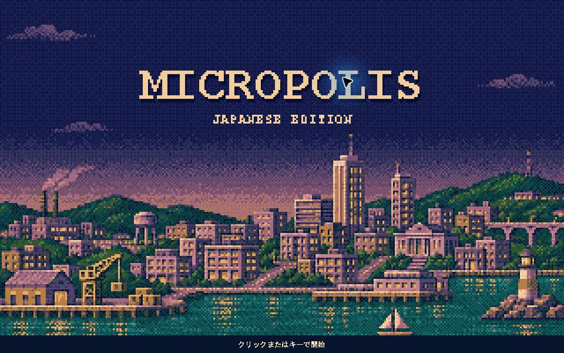

# 起動スプラッシュ

独自の港町を描いたスプラッシュを起動時に約1.8秒表示します。
クリックまたは任意のキーでスキップできます。タイマーで進行し、UIスレッドで待機しません。
音楽パックにタイトル曲がある場合はスプラッシュから新規都市画面まで同じ曲を維持します。

無効にする場合は起動時に `-Dmicropolis.splash=false` を指定してください。
開発・表示確認用には `-Dmicropolis.splashMillis=60000` で表示時間を変更できます（300〜60000ミリ秒）。
画像の読み込みに失敗した場合も通常起動します。

生成元のPNGを実行時に320×200・24色へ描画し、文字を合成します。
画面の使用可能な範囲に合わせて最大3倍の整数倍で表示し、拡大にはニアレストネイバーを使います。
320×200が収まらない画面ではスプラッシュを省略します。

2026-11-02、Windows / Java 25で日本語案内の表示、クリックによるスキップと新規都市画面への遷移を確認しました。

## 素材の作成元

`src/main/resources/images/splash-city.png` は2026-11-02、OpenAIの内蔵画像生成ツールで新規生成した素材です。
商用ゲームの画面・ロゴ・キャラクター・ROMは入力していません。
本プロジェクトの追加素材としてGPLv3で提供します。生成AIの使用についてこの記録を保持します。

使用プロンプト:

> Use case: stylized-concept. Create an ORIGINAL production splash background for the open-source city-building game Micropolis. Landscape 8:5 aspect ratio, ideally 1280x800. Visual language: circa 1990 computer-game pixel art, deliberately chunky coherent pixel grid resembling a 320x200 image enlarged by nearest-neighbor, limited 24-color palette, ordered dithering, hard edges, no antialiasing, no smooth gradients. A calm original fictional coastal city at dusk, geometric mid-rise and a few taller buildings, small illuminated amber windows, dark navy sky, dusty purple horizon, teal harbor in foreground, warm ochre highlights. City occupies bottom 60 percent; upper 40 percent mostly clear sky with just a few pixel clouds, reserved for a title to be drawn by application code. No text whatsoever, no logo, no border, no interface. Original composition and architecture; no recreation of any existing game title screen, no commercial characters or branded landmarks. Full bleed opaque artwork.

生成画像には24色を超える色が含まれるため、実行時の固定パレットで色数を揃えています。
タイトルは画像に含めず、アプリケーションで描画します。
